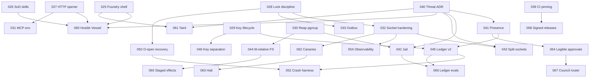

# CAPT-UPG-025 → 068 — Same-UID Hardening and Evolution Program

**Status:** proposed campaign (no item is implemented by this document)
**Baseline:** `80d3b82ed9841818dbcc60e6098d8ae6de74fbcd` (2026-10-08)
**Machine-readable backlog:** [`capt_upg_025_backlog.json`](capt_upg_025_backlog.json) (authoritative for scope, dependencies, acceptance and status)
**Agent workflow:** [`../workflows/CAPT_UPG_025_AGENT_INTEGRATION_WORKFLOW.md`](../workflows/CAPT_UPG_025_AGENT_INTEGRATION_WORKFLOW.md)
**Queue tool:** `python3 scripts/upg_queue.py {validate|ready|claim|set|show|status|graph}`

Provenance tags follow `CAPT_HARDENING_BACKLOG.md`, with two additions: **[V]** reproduced; **[V-code]** read deterministically from source but not executed; **[R]** reported lead; **[P]** proposal. A proposal is never a defect claim.

---

## 1. Thesis: the adversary moved

Up to this baseline, CAPT's hardening has defended against two things: **bugs inside CAPT** (idempotency, crash seams, replay, contract drift) and **untrusted model output** (ClaimGuard, verification, the approval-digest binding). Inside those limits the engineering is rigorous.

The review found a third adversary class the architecture does not yet model: **a model-driven process running as the operator's own UID.** CAPT itself creates these:

- Hermes is launched with `toolsets="terminal"`.
- `terminal.local` runs with no OS confinement; `filesystem_root` constrains only the cwd. This was reproduced: a scoped run wrote `../outside.txt`.
- `code.execution` runs the same way.

Such a process can read `~/.capt/runtime.token` and become the operator on the socket, read the ledger and state key, and replay or forge anything a human could. The approval, lease and evidence planes remain correct *bookkeeping*. Against this adversary they are not *enforcement*.

Every structural item in this campaign follows from one rule:

> **Authority must require something a model process cannot obtain, not just something a model process is asked not to touch.**

### Adversary classes

| Class | Who | Holds today | Holds after campaign |
|---|---|---|---|
| A0 | Remote network attacker | Mostly; but credentials leak on provider redirects (UPG-027) | Yes |
| A1 | Other local OS user | Mostly; but `ps` exposes the keychain key on argv (029) and the Hermes prompt (035); token file permission race (032) | Yes |
| A2 | Same-UID model-driven process | **No.** Token theft gives self-approval; scope is advisory; ledger and key are readable | Approvals need presence (041); model processes are jailed (042); authority socket is peer-checked (043); canaries and halt (062/063) |
| A3 | Root / OS compromise | No (out of scope) | No; external anchors (045) make tampering detectable after the fact |

UPG-040 turns this table into an ADR. Until it merges, product claims about "governed" execution should name the class they hold against.

---

## 2. Waves

Waves are a suggested reading order. The JSON dependency graph is binding; waves are not. `upg_queue.py ready` always reflects the actual frontier.

### Wave 0 — Stop the bleeding (P0, mostly small and independent)

| ID | What | Tag |
|---|---|---|
| 025 | Remove `os.system` from the Foundry harness. Shell injection reachable from model-authored procedures. | V |
| 026 | Remove model self-publication; reviewer ≠ author; self-reported runs cannot verify a procedure | V |
| 027 | One no-redirect, bounded HTTP opener for credentialed calls, plus a CI gate against bare `urlopen` | V |
| 028 | `read_recent_events` takes the lock; AST test enforces lock discipline for the shared connection | V |
| 029 | Keychain key lifecycle: no regeneration on transient failure, no `-U`, no key on argv, key fingerprint stored in the ledger | V-code |
| 030 | Reap the process group after leader exit | V |
| 040 | ADR: same-UID threat model (operator-owned) | V |

Most Wave-0 items are under 100 lines plus tests. 029 is the exception: it touches key custody, so it needs its ADR first.

### Wave 1 — Draw the boundary for real (P1)

The tiers below are ordered so detection lands before prevention:

1. **Detect:** tripwire canaries (062) plus a global halt (063). Cheap, and useful the day they merge.
2. **Prevent decision forgery:** Human Presence Attestation (041) and a split, peer-checked authority socket (043).
3. **Prevent reach:** the model-process jail (042) and descriptor-relative filesystem operations (044).
4. **Prove it:** the Hostile Vessel suite (060) turns every escape class into a CI regression.

Also in this wave: transport and process hygiene (031 MCP environment, 032 socket server, 033 outbox, 034 idempotency fingerprints, 035 prompt off argv, 036 Swift pipe deadlock, 037 plugin paths, 038 support matrix).

### Wave 2 — Integrity and scale (P2)

- Ledger integrity v2 (045): the chain covers the full envelope, signed external anchors, and a deep projection audit.
- Purpose-separated keys bound to each ledger (046).
- Restart recovery proportional to open work (050).
- A crash-consistency property harness over the existing `_test_fault` seams (052).
- Parser fuzzing (053).
- A redacted observability spine (054).
- Model-taint labels (061).
- Legible approvals (064).
- Staged effects with preview (065).

### Wave 3 — Leverage (P3)

- Ledger-native model regression evals (066).
- Council dissent as a verification router (067).
- Signed release provenance (068).
- Retiring one-off migrations (051).
- A generated state-of-truth surface (055).

---

## 3. Novel additions: engage → extend → stress-test → synthesize

### 3.1 Human Presence Attestation (041)

**Engage.** Make "the human approved this" a cryptographic fact rather than a socket-session fact. The signed Swift app holds a Secure Enclave P-256 key whose use requires LocalAuthentication (Touch ID or password). Each decision is a signature over `{requestId, decision, bindingDigest, expiresAt}`. RuntimeService verifies it against a public key that was pinned into the ledger at enrollment.

**Extend.**
- The same key signs ledger head anchors (045), giving an operator-attested chain.
- Rotation and revocation become ledger events.
- A second enrolled device enables two-person rules for designated scopes. The Council could require a quorum of human attestations before a high-tier launch.

**Stress-test.**
- *Approval fatigue:* Touch ID on every low-risk action trains reflexive tapping. Countered by 064's risk tiers and batching.
- *Headless and Linux:* there is no Secure Enclave. The fallback must be explicit and visibly weaker, never silent.
- *Device loss:* recovery needs a documented ceremony (backup key held offline).
- *Same-UID attacker driving the UI via accessibility APIs:* mitigated by LocalAuthentication's system-owned prompt, but synthetic events against the app itself must be considered. Confidence: medium. Validate on current macOS.
- *Replay:* the binding includes `requestId` and expiry, and the aggregate refuses a second consumption.

**Synthesize.** This is the highest-leverage structural change. It converts every existing approval binding (prompt digest, authority profile, skill bytes) from "hard to tamper with in transit" into "impossible to forge without the operator's finger." Ship it behind policy `approval.presence=required`, defaulting to required on macOS once enrollment UX exists.

### 3.2 Model-process jail (042)

**Engage.** Run Hermes, `terminal.local` and code execution where `~/.capt`, the keychain and `runtime.sock` do not exist, and writes are limited to the lease scope.

**Extend.** On macOS the strongest practical option is a dedicated low-privilege user (launchd-managed, with lease scope shared via ACLs). `sandbox-exec` profiles are a quicker interim. `readiness()` reports `confined` or `unconfined`, and leases above read-only require `confined`.

**Stress-test.**
- `sandbox-exec` is a deprecated interface that is still shipped. It works today, but it is unwise as the only long-term control.
- A separate user complicates file ownership in worktrees. ACLs or a staging-and-apply flow (065) resolve this.
- Hermes may need network and package caches. Profiles must allowlist them, or the egress proxy pattern from `inversion_guardian` should be reused (its pinned-DNS check is already correct).

**Synthesize.** Do it, in two steps: profile-based confinement first, a dedicated user second. It also makes `filesystem_root` mean what its name says.

### 3.3 Hostile Vessel (060)

**Engage.** A deterministic adversarial driver, with no LLM, replays every escape class found so far against a composed runtime in CI. Each class maps to the UPG item that closes it. Classes not yet closed are `xfail(strict=True)`, so the day an item lands, CI forces the marker to be removed.

**Extend.**
- Name the classes with the AFP taxonomy so failures propagate with a stable vocabulary.
- Publish the suite as a standalone red-team benchmark for governed agent runtimes. As far as I know, no widely used public suite targets same-UID escapes from agent governance layers specifically.

**Stress-test.** A scripted adversary only covers known classes. Add a nightly LLM-driven variant that runs inside the jail with an explicit "try to escape" objective, and record any new class as a new deterministic test.

**Synthesize.** This is cheap, compounding and externally legible. It is also the artifact that best demonstrates CAPT's governance claims to a skeptical reviewer.

### 3.4 Model-taint provenance (061)

**Engage.** UPG-025 and 026 share one root cause: model-originated text reached an authority position (executable steps, a reviewer identity) without being labelled. Label every persisted string by origin, and have authority positions refuse model-tainted values unless a presence-attested approval names that exact value digest.

**Extend.** Taint carries into memory retrieval, which gives a memory-poisoning defense: tainted memories can inform prompts but never authorize. It also feeds ClaimGuard, so a claim supported only by tainted evidence cannot be promoted.

**Stress-test.**
- Label explosion: the label must be coarse (origin class plus run id), not character-level.
- Legacy rows: default them to `unknown`, which is treated as tainted. That is correct and also annoying, so provide an operator re-attestation flow.
- Taint is lost through any path that rebuilds a string outside the typed contracts. The contract layer has to be the choke point.

**Synthesize.** Do it, but after 040 and 025. It closes the bug class rather than the instances.

### 3.5 Tripwire canaries (062) and halt (063)

**Engage.** Plant decoy credentials (a token-shaped file and a decoy provider key ref) that nothing legitimate ever uses. Presenting one triggers a governed lockdown: revoke leases, suspend runs, kill confined groups, alert.

**Stress-test.** A careful attacker reads the real token, not the `.bak`. Canaries catch opportunistic and scripted behaviour (globbing `~/.capt/*`), which is what a prompt-injected agent typically does. This is detection, not prevention, and it is labelled that way. It is consistent with AGENTS.md: it is explicit, documented, and not a hidden trap against forks.

**Synthesize.** Ship it early in Wave 1. It is the best ratio of value to effort in the campaign.

### 3.6 Staged world effects (065)

**Engage.** Today the operator approves *intent* (prompt digest and scope). Instead, model file effects land in a copy-on-write overlay, CAPT renders the diff, and one approval applies the whole change set atomically, with world receipts and reversal handles.

**Stress-test.** It needs conflict detection against external edits (before-digests), applies must be all-or-nothing (the existing reversal mechanism helps), and large binary diffs need summaries.

**Synthesize.** This is the natural end state of the World Receipt design, and it pairs with 064 so approvals become legible.

### 3.7 Ledger-native evals (066) and the Council router (067)

**Engage.** "The model is replaceable" is CAPT's headline claim. Make it measurable: every verified mission exports a content-addressed eval case, and `capt eval --model X` replays the cases inside the jail. The output is a pass-rate delta with Wilson intervals, recorded as observations.

**Extend.** Council dissent becomes a deterministic attention allocator. High disagreement forces human verification; unanimity only selects which verifier runs and never promotes a claim on its own.

**Synthesize.** These two are Wave 3 because they need jailed replays (042) and trustworthy ledgers (045). They are the most product-differentiating items, and both are proposals rather than fixes.

### Ideas considered and rejected

- **More at-rest encryption as the A2 defense.** Same-UID access to the key makes it moot. The fix is key custody (029, 041, 046), not more ciphertext.
- **LLM-judged risk tiers for approvals.** A model deciding how carefully a human should review a model's request would reintroduce the problem. Tiers stay a pure rule table (064).
- **Distributed consensus for the ledger.** It is out of proportion for a single-operator local-first runtime. Signed anchors give tamper evidence without the operational cost.

---

## 4. Epistemic status and known unknowns

- **High confidence:** every [V] item; the A2 analysis for `terminal.local` (reproduced); `urllib` forwarding credentials on redirect in CPython 3.13 (reproduced).
- **Medium:** the `security` CLI exit-code semantics behind 029 (item-not-found has a dedicated code, which I believe is 44; locked and interaction-denied return other codes). Confirm on the target macOS before writing the classifier.
- **Unknown:**
  - What Hermes `--safe-mode` restricts. It could narrow the A2 surface for the Hermes path; inspect the installed Hermes version.
  - Whether Hermes can take a prompt from stdin or a file (035).
  - Atheris wheel availability for CPython 3.13 (053 has a Hypothesis fallback).
- **Not reviewed in depth at baseline:** Council internals, the Cloudflare/Docker/Inversion sandbox backends (beyond the egress guardian, which looked correct), SOMA, the TUI, and most of the Swift sources. A second review pass is worth scheduling after Wave 1.

## 5. Definition of done for the campaign

1. Every P0 and P1 item is `merged`, or explicitly `deferred` with an operator note.
2. The Hostile Vessel suite has no `xfail` markers left for any A2 class.
3. The trust-boundary document and README make no governance claim that is stronger than the ADR's adversary table.
4. The proof ladder in `AGENTS.md` (`source present → tested → integrated → installed → live dependency proven → release proven`) is recorded per item in its PR. The campaign does not claim "release proven" for anything without an exact-SHA release receipt.
